# 🔍 Awesome Data Analysis & Faceted Search 📊

**A curated, production-ready directory of cutting-edge SaaS platforms, aggregation engines, and open-source search systems for faceted navigation and big data analysis.**

  
  
  
  
  
  
  

*Empowering developers, data analysts, and search engineers to build lightning-fast faceted search interfaces, multi-dimensional aggregation pipelines, and self-hosted analytics.*

---

## 📑 Table of Contents
- [📌 Sector Overview & Market Dynamics](#-sector-overview--market-dynamics)
- [☁️ SaaS Products](#️-saas-products)
- [💻 Open-Source GitHub Projects](#-open-source-github-projects)
- [🛠️ Additional Open-Source & Enterprise Frameworks](#️-additional-open-source--enterprise-frameworks)
- [📈 Star History](#--star-history)
- [🤝 How to Contribute](#-how-to-contribute)
- [💖 Support & Sponsor](#-support--sponsor)
- [⚠️ Disclaimer](#️-disclaimer)

---

## 📌 Sector Overview & Market Dynamics

The global enterprise search, retrieval, and faceted data analytics market is currently valued between **$5.8B and $7.4B (2025–2026)**, expanding at a robust **~9% CAGR** toward **$15B+ by the early 2030s**. This growth is heavily accelerated by the confluence of conversational AI, Retrieval-Augmented Generation (RAG), and structured multi-attribute facet filtering.

Despite the dominance of major cloud infrastructure providers, the sector remains **highly fragmented**:
- **No Single Monopoly:** The ecosystem is split among hyperscale cloud environments (AWS, Microsoft, Google), specialized search-as-a-service platforms (Algolia, Coveo), and resilient open-source engines (Elasticsearch, Meilisearch, Vespa, Typesense).
- **Data Sovereignty & Scale:** As data volumes swell into terabytes and petabytes, engineering teams frequently transition from query/record-metered SaaS models to self-hosted, cloud-native aggregation engines to eliminate compounding pricing and retain complete data control.

---

## ☁️ SaaS Products

A comparison of leading hosted search platforms with explicit faceted navigation controls, granular attribute bucketing, and production SLAs.

| Platform | 🏢 Company Scale (Valuation / Revenue) | 💳 Starting Tier Pricing | 🎁 Free Tier / Free Trial Limits | ⚙️ Key Faceted Search Capabilities & Architecture |
|---|---|---|---|---|
| **[AWS OpenSearch Service](https://aws.amazon.com/opensearch-service/)** | **~$2.7T+ Market Cap** (Amazon parent; AWS run-rate ~$184B/yr) | **$0.036/hour** (~$26/month on-demand for baseline `t3.small.search` node) + EBS storage ($0.10/GB-mo) | **AWS Free Tier (12 Months):** Up to 750 hours/month of single-AZ `t2.small.search` or `t3.small.search` instance + 10 GB/month optional EBS storage | Managed fork of Elasticsearch 7.10.2; uses terms and date histogram aggregations on keyword fields; `shard_size` parameter governs aggregation accuracy across distributed shards. |
| **[Elasticsearch Cloud](https://www.elastic.co/)** | **~$7.9B Market Cap** (NYSE: ESTC; ~$1.8B annual revenue) | **$99/month** (Standard Tier, billed on provisioned resource consumption) | **14-day free trial** with no credit card required; limited to 1 active deployment capped at up to 8 GB total RAM (4 GB RAM per AZ across 2 availability zones) | Canonical aggregation-based faceting via `terms` and `date_histogram` aggregations; reports `doc_count_error_upper_bound` for approximate multi-shard counts. |
| **[Algolia](https://www.algolia.com/)** | **~$2.25B Valuation** (Series D; ~$100M+ ARR) | **$0/month base** on Grow Plan + pay-as-you-go overages ($0.50 per 1,000 extra searches; $0.40 per 1,000 extra records) | **Free forever ("Build" plan):** Up to 10,000 search requests/month and 50,000 stored records (max 1 GB app storage, 10 KB/record max) | Declarative faceting via `attributesForFaceting` with `filterOnly` and `searchable` modifiers; returns `exhaustiveFacetsCount` indicator for exact vs. approximate counts. |
| **[Coveo](https://www.coveo.com/)** | **~CA$245M Market Cap** (TSX: CVO; ~US$150M annual revenue) | **$600/month** (Base Tier entry; enterprise contracts typically start at $30,000+/year) | **14-day free trial** (Evaluation sandbox with unified indexing and relevance tuning, no credit card required, production use restricted) | Enterprise relevance platform with `FacetOptions` (`allowedValues` up to 25 items, `customSort`, `filterFacetCount`, hierarchical facets, and generative answering). |

---

## 💻 Open-Source GitHub Projects

Explore the most capable open-source search engines, aggregation frameworks, and self-hosted faceted exploration platforms. Ranked by GitHub community stars.

| Project | ⭐ GitHub_Stars | 💻 Language | 🚀 Primary Faceting Architecture & Highlights |
|---|---|---|---|
| **[Elasticsearch](https://github.com/elastic/elasticsearch)** |  | Java | The benchmark distributed search and analytics engine. Implements facets via canonical `terms` and `date_histogram` aggregations returning bucket counts; configurable `shard_size` balances precision vs. distributed compute overhead. |
| **[Meilisearch](https://github.com/meilisearch/meilisearch)** |  | Rust | Performance-first search engine with granular `filterableAttributes` (`filter.equality`, `filter.comparison`, `facetSearch`). `maxValuesPerFacet` optimizes facet memory consumption and prevents wasted indexing cycles. |
| **[Typesense](https://github.com/typesense/typesense)** |  | C++ | Blazing-fast, in-memory typo-tolerant search engine. Computes facet counts via `facet_by` parameter; facet aggregation pipeline runs reliably to completion even when hit queries are throttled by `search_cutoff_ms`. |
| **[Manticore Search](https://github.com/manticoresoftware/manticoresearch)** |  | C++ | High-performance open-source database designed for search and stream filtering. Features SQL-compatible aggregation syntax (`FACET` clause) alongside JSON API for low-latency faceted navigation and numeric bucketing. |
| **[Quickwit](https://github.com/quickwit-oss/quickwit)** |  | Rust | Cloud-native search engine built directly on object storage (Amazon S3, Azure Blob, GCS). Implements distributed aggregation queries to compute fast facet buckets over terabytes-to-petabytes of log and event datasets. |
| **[Vespa](https://github.com/vespa-engine/vespa)** |  | C++ / Java | Declarative YQL grouping language enables multi-level, statistical faceting (`sum`, `avg`, `min`/`max`, percentiles) and hit sampling within buckets in a single query execution pass. |
| **[Apache Solr](https://github.com/apache/solr)** |  | Java | Mature, enterprise-grade search platform on Apache Lucene. Renowned for pioneering the Facet Module (field faceting, range faceting, pivot/decision-tree facets, and JSON Facet API for nested multi-dimensional aggregations). |

---

## 🛠️ Additional Open-Source & Enterprise Frameworks

- **[Sinequa Angular SBA](https://github.com/sinequa/sba-angular)** () — Component-based enterprise search UI framework. `BsFacetModule` provides out-of-the-box widgets (`sq-facet-card`, `sq-facet-tree`, `sq-facet-range`, `sq-facet-timeline`) fed by backend aggregations.
- **[Mindbreeze Inspire](https://help.mindbreeze.com/)** — Enterprise search appliance featuring a rich REST API for dynamic metadata facets, hierarchical facet exploration, and customizable sort orders.
- **[Lucidworks Fusion](https://doc.lucidworks.com/)** — Enterprise search orchestration built on Apache Solr with pre-integrated analytics and faceting controls.

---

## 📈 Star History

---

## 🤝 How to Contribute

Contributions are warmly welcomed! Help make this the most complete, count-accurate, and transparent resource for search engineers and data analysts:

1. 🍴 **Fork** the repository.
2. 🌿 **Create a branch**: `git checkout -b feature/new-search-engine`.
3. 📝 **Add/edit entries** in `README.md` following the tabular layout (include name, official link, transparent pricing/stars, and architectural details).
4. 🚀 **Submit a Pull Request** with a clear explanation of why the addition is relevant.

---

## 💖 Support & Sponsor

If you find this repository valuable for your data architecture, search infrastructure research, or engineering stack:

- ⭐ **Star** this repository to show your support and improve discoverability!
- 🍴 **Fork** and share it with your fellow engineers, data teams, and community.
- ☕ **Buy me a coffee**: Support ongoing maintenance and curated technical research via the **[GitHub Sponsors Dashboard](https://github.com/sponsors/ishandutta2007)**.

Thank you for being part of the open-source community! 🚀

---

## ⚠️ Disclaimer

- This is a **community-curated** list — not exhaustive and not an endorsement.
- Faceted search platforms handle potentially sensitive data and query patterns; enforce access controls and validate facet counts before relying on them for business decisions.
- **Facet counts on sharded indexes can be approximate.** **Elasticsearch and OpenSearch** return `doc_count_error_upper_bound` and `sum_other_doc_count`—if the error bound is nonzero, your facet counts are approximate. Raise `shard_size` (e.g., to 200) when accuracy matters more than speed. **Meilisearch** adds overhead at indexing and search time for every filterable attribute—use granular `filterableAttributes` and lower `maxValuesPerFacet` to avoid wasted work. **Algolia** exposes `exhaustiveFacetsCount`—check it before treating counts as exact. **Vespa** is the most expressive for statistical faceting but has a steeper learning curve than simple terms aggregations. Validate whether you need simple counts (Elasticsearch, Meilisearch) or rich aggregations (Vespa) before committing.

---

  <b>Built with ❤️ for search engineers, data analysts, and architects building modern faceted navigation.</b>

